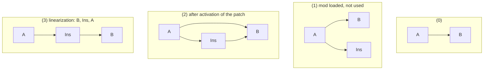
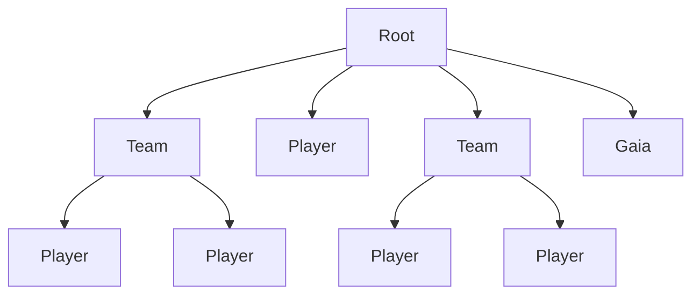
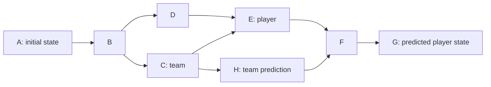

# `nyan` Design Ideas

What are the ideas behind `nyan`?

## Components

```
                                       +--> type database  --+
                                       |          |          |
--> nyan language -> lexer -> parser --+          |         C++ API -->
                                       |          v          |
                                       +--> value database --+

                                       \___ nyan database ___/
```

`nyan` has two interfaces:
* The C++ API
* The input/configuration in `nyan`-language

The C++ API is used by a game engine so that `nyan` can provide game content
definitions.


## Application and Content Separation

The game engine application and game content should be separated.
The content format is defined by the engine, because the way content is displayed and behaves is implemented in the application.

`nyan` is designed as one possible content provider through the `nyan` database.
The application loads the data schema into the `nyan` database.
The schema describes the allowed data structures and value types.
The game engine defines the schema so it can later access and update records by the structure, names and types it has declared through it.

The `nyan` language is used to describe the content and engine declaratively.
It does not provide the possibility to write code, so there is no need to sandbox it and prevent code execution.

The game engine is responsible for setting up the data schema, loading data, changing data and handling query results obtained from the `nyan`-database.

In particular this means the engine is responsible for the load order of possibly conflicting records:
If changes are planned to be done on the same data record, the engine has to decide about the order.
In practice, this is mainly determined by the game logic implemented in the engine.
The progressing in-game-time and world state can provide the correct order for changes in the `nyan` database e.g. power upgrades.

It is important to keep in mind that the `nyan` framework merely provides a configuration tool and alterable state storage, all the algorithmic logic has to be implemented in the application that embeds `nyan`.


## Concept

The overall concept of `nyan` revolves around the possibility to access and modify the stored data at any time with little possibility for conflicts or ambiguity so that multiple change requests can be active at once.

The `nyan` database stores records as key-values.
Keys are human readable names.

The idea is now that a result to a query of a key can be a combination of values, depending on how the keys are arranged.
The database also stores the history of changes to the values.
By the usage of a custom timestamp, any point in this history can be queried.

The `nyan` language is designed to be human read- and writable as it is the primary entity content creators will have contact with.
This means it must be read and written intuitively.

The application has to provide the schema by which data is then organized.
The schema defines the permitted structure and value types of data records.
Hence, the schema must be loaded into the `nyan` database by the application before content can be added through the `nyan`-API.
The published data schema equals the **content-API** of the application:
Configuration can be performed on the structures and types defined by the schema.

Run-time code plugins for the application may require schema extensions, for example for adding data fields to existing game objects so that they can store properties accessed by a scripting language.

The concept used for the `nyan` framework is to describe both the schema and content in the same language as the data records, which is the `nyan` language.


### Object Storage

The approach for this unification is the storage of `nyan`-*objects*.
Such an object stores an arbitrary number of *members*, which are key-value pairs.
A member always has a *data type*, which restricts the kind of values to be allowed.
Because a `nyan`-object simultaneously declares data types and their values, they are a unification of the concept of a `class` and an `object`.

`nyan`-objects are organized in *namespaces*, which are created by the directory hierarchy of files where they are defined in.
`nyan`-objects can be identified uniquely through their **fully qualified object name (fqon)**, which is the combination of the directory structure and their object name.
The fqon allows to reference objects unambiguously from independent modding projects.
*Namespaces* and fqons are further presented in [Section namespaces](#namespaces).


### Data Inheritance

`nyan`-objects can inherit data from other objects.
This inheritance allows creation of a data inheritance graph, where objects can inherit data from other objects and apply modifications to it.
The modification is done by an operator and a value.

When a member value of an object is queried, the result is determined by walking down the inheritance tree of the object hierarchy, starting at the root object(s).
On the way, modifications are accumulated.
This mechanism allows changes made to parents to be propagated to all of its children.


### Data Modifications

Modifications to the data are stored in the database in the form of **patches**.
All of the possible changes are therefore accessible by name, and patches can change patches.
The patch activations are triggered by the game engine application, possibly according to its implementation of initial data loading, game initialization, game logic, etc.

All the modifications are tracked on a timeline, so that rollbacks to any previous state are possible.
This is built into the design so predictions of the game state can perform changes in the `nyan`-database, and if those are no longer valid, one can go back to a previous point in time.

These features were chosen to allow easy modding and integration for games.
Data packs can contain game content, stored in a directory hierarchy of `.nyan` files.
Those data packs are essentially a mod pack for the game engine, it provides or changes the configuration for the application.
The type system requirements of data eliminate errors during runtime of the game, as most of the problems can be detected at load-time of the mod.
When this mod is activated (load order, point in time) has to be determined by the engine.


## Input Language

The input language, called the `nyan` language, has to be portable and human readable.
The storage format is plain text, so that they can be edited with arbitrary text editors.
They could be loaded and presented in a fancy GUI, but such a program is not required.

The language is designed to be very compact, but readability is given priority over memory consumption.
A major goal was to create the language in such a way, that data definitions and changes can be expressed without redundancy.
The main goal was to create it in a way that it is editable intuitively.
For that, a syntax similar to Python was chosen.
The style was adapted for the concept of `nyan`, but remained "pythonic".
Hence, it should be easy to read and write even for people with little or no programming experience.

Python's whitespace indentation is relevant for stating code blocks, this is also true for `nyan`.

In the following sections, relevant language components are introduced.
This includes the definition of `nyan`-objects, the allowed data types, the inheritance declarations, operators and value assignments and the definition of patches.

### Object Definition

A `nyan`-object is a named group of key-value pairs.
The name of the group is the `nyan`-object name.
Key-value pairs assigned in this object are called *members*.
Each initial definition of a member must be annotated with a type.

The member type is defined after the member name with `keyname : type = value`.
The basic structure for an object definition is this:

```python
ObjectName():
    member_name : TypeName = value
    another_member : int = 123
    member_without_value : SomeType
    ...
```

The order of members does not matter and there must not be two members with the same name in an object.
A member may have no value.
An object that has a member with no value is called *abstract*; the member may be defined in the object itself or inherited from a parent object.
This is a way of forcing derived objects to specify a member value.
This mechanism will be elaborated in [Section Values and Operators](#values-and-operators).

Objects can also be defined within another object.
The inner one is a *nested* object, and can contain nested objects itself.
The purpose of nested objects is to allow further grouping, which is also supported by the naming schema for them: The name of a nested object is a combination of the name of its parent and the nested object name.
This namespace creation and its reference procedure are presented in [Section namespaces](#namespaces).

### Types

Types in the `nyan` language are introduced to enable static error analysis.
The allowed data types for a member are either *primitive*, *collection* or *object*.
Primitive and collection types are built into the language, whereas object types are defined by the user.

Built-in primitive types are present in many programming languages, for example in Python.
The available primitive types in the `nyan` language are presented in the following table.

| Type | Example | Description |
| ---- | ------- | ----------- |
| `text` | `"random text"` | Immutable string constant |
| `int` | `1337` | Numeric type for integers |
| `float` | `42.235`, `inf` | Numeric type for floating point numbers |
| `bool` | `True`, `False` | Truth type for boolean operations |
| `file` | `"./name"` | Filename, relative to the file this value is defined in. If the path is absolute, returned as-is. |

The numeric types `int` and `float` are strictly separated: a member only accepts literals of its own type.
For example, `speed : float = 5` is rejected and must be written as `speed : float = 5.0`.
Integers can't be divided because the result would need a rounding rule, so scale values with a `float` member.

The collection types allow to unite multiple values in one container.
Valid collection types are `set`, `orderedset` and `dict`.
A `set` and an `orderedset` have an element type which is declared after the collection type, a `dict` has a key type and a value type.
Example definitions of members with primitive and collection types are provided in the following listing.

```python
SomeObject():
    some_member : text = "some boring string value"
    another_member : int = 42
    third_member : float = 123.456
    fourth_member : bool = True
    fifth_member : file = "./directory/graphic.png"

    set_member : set(int) = {13, 37, 42, 13, 42}
    orderedset_member : orderedset(text) = o{
        "this", "is", "this", "a", "test"
    }
    dict_member : dict(text, int) = {"one": 1, "two": 2}
```

The difference between `set` and `orderedset` is only observable in query results.
An ordered set strictly keeps its element order, elements that already were in the set are moved to the end when a new element is inserted.
The resulting value of `orderedset_member` from the listing above therefore is `["is", "this", "a", "test"]`, the value of `set_member` is `{42, 13, 37}` but the numbers could also be in any other order.
The right hand side value also has a different creation, a `set` value is created by `{...}`, an `orderedset` value is created by `o{...}`, a `dict` value is created by `{key: value, ...}`.
A set can also be assigned an ordered set value, but not the other way round, while dropping the order of elements is no problem, creating it when none was intended would be ambiguous.

A `list` type was omitted deliberately from the design to avoid the complexity needed for list combinations.
If a sensible way of merging lists is found, lists can easily be added to the `nyan` framework later.

The third possible type for a value is a `nyan`-object.
This means an object can be used as a value for a member or in a collection of values in any other object.
The type name of a `nyan`-object is its object name.
If an object `B` inherits from an object `A` (as presented in [Section Inheritance](#inheritance)), then `B` is also of type `A`, and can therefore be used as a value for a member of type `A`.

Object types are always concrete object names; there is no generic "any object" type.
An example of the application of objects as types can be seen in the following listing.

```python
ValueObject():
    funny_member : text = "not funny"

DerivedObject(ValueObject):
    funny_member = "still not funny"

TestObject():
    # can hold ValueObject and everything derived from it:
    some_member : ValueObject = DerivedObject
```

Every type can be modified with `optional(...)`, `children(...)` or `abstract(...)`.
A value of `optional(T)` may additionally be `None`, which expresses "no value" on purpose.
A value of `children(T)` must be an object that inherits from `T`, `T` itself is not allowed.
A value of `abstract(T)` may also be an abstract object, i.e. one that still has members without values.
This is useful to reference API objects as values and force the values to be filled in later, e.g. by a patch.
Modifiers can be combined like `abstract(children(T))`.
The element type of a container and the key type of a dict cannot be `optional`, but the value type of a dict can: `dict(text, optional(int))`.

### Inheritance

`nyan`-objects can inherit from one or multiple parent objects.
Inheritance is transitive, so a child object is of type of all its parent objects, and the parents of those, and so on.
An example for the syntax to declare inheritance relations is presented in the following listing.

```python
ParentObject():
    ...

ChildObject(ParentObject):
    ...

RandomObject():
    ...

GrandchildObject(ChildObject, RandomObject):
    ...
```

Inheritance is used to provide a child with all the members of its parent.
This mechanism enables reuse of parental base values as well as parent-relative modification of members.
How the value can be updated depends on the type of the member.
Each type has a number of allowed operators, presented in [Section Values and Operators](#values-and-operators).
A child object therefore gains access to all members of all parents and can build upon them by operations specified by the member type.

There can be more than one parent for an object, which allows multiple inheritance, as presented in [Section Multiple Inheritance](#multiple-inheritance).
The problems introduced with this mechanism are discussed in [Section Multiple Inheritance](#multiple-inheritance).

Inheritance allows to assume that a child object has a member of a parent: The member was inherited and therefore is also present in the child.
An illustration can be seen in the following listing, where each `ValueDemo.member` set entry can be queried for the value of `a`, it is prescribed by `BaseObject`.

```python
BaseObject():
    a : int = 0

ChildObject(BaseObject):
    a = 1
    b : int = 10

OtherChild(BaseObject):
    a = 2
    c : int = 20

ValueDemo():
    member : set(BaseObject) = {ChildObject,
                                OtherChild}
```


### Values and Operators

Each member in an object has a type, as described in the [Types Section](#types).
When inheriting (see [Section Inheritance](#inheritance)), the value of the current object can be defined relatively to the parent object.
This means that when the current object's member value is requested, it is constructed by evaluation of the parent's member value followed by the application of a type-specific operator and value.
All member types support the assignment operator `=`.
Other allowed operators are listed in the following table.

| Type | Operator | Description |
| ---- | -------- | ----------- |
| any | `=` | Value override |
| `text` | `+=` | String appending |
| `int` | `+=`, `*=`, `-=` | Arithmetic operations |
| `float` | `+=`, `*=`, `-=`, `/=` | Arithmetic operations, the divisor must not be zero |
| `bool` | `&=`, `\|=` | `and` and `or` operation |
| `file` | `= "./moist/cake"` | Assignment only (maybe `/=` in the future?) |
| `set(type)` | `= {value, val, ..}` | Assignment |
| `set(type)` | `+= {..}`, `\|= {..}` | Set union |
| `set(type)` | `-= {..}` | Element removal |
| `set(type)` | `&= {..}` | Set intersection |
| `orderedset(type)` | `= o{value, val, ..}` | Assignment |
| `orderedset(type)` | `+= o{..}` | Add values to end |
| `orderedset(type)` | `-= o{..}`, `-= {..}` | Element removal |
| `orderedset(type)` | `&= o{..}`, `&= {..}` | Keep only those values |
| Object | `=` | Assignment |

Only non-abstract objects can be assigned as values, and their type must match the member type.
An object is `abstract` when any of its members has no value, no matter whether the member is defined in the object itself or in a parent object.
The type constraint guarantees access to members defined by that object or any of its children.
Members do not vanish, so they can be accessed from any child object.
Since only non-abstract objects can be values, a request to any member value can always be satisfied; this in turn forces the object to be initialized.
That way a content API (i.e. abstract objects) can force values to be set.
One exception exists: a member typed `abstract(T)` may also hold abstract objects (see [Section Types](#types)).

This also allows that the API is further refined, for example by a mod that introduces an extension to an existing API, and still forces any usage of it to fill in values that the behavior/engine code can then use for the game simulation or any other component to be configured.


### Patch Definitions

Values would remain the same forever if there was no way to change them.
In order to modify them, `nyan` uses *patches*.
A patch is a `nyan`-object which specifies changes to members of another `nyan`-object, which is its patch *target*.
As a patch is a `nyan`-object, it can be target of another patch.
Hence, the system allows to create mods for mods.

The *activation* or *application* of a patch is triggered via the `nyan`-database-API (see [Section Application Interaction](#application-interaction)), thus the decision is not done in the `nyan` framework, but in the software that uses it.
One patch can be applied multiple times, then it will perform all the changes once again.

A patch targets exactly one `nyan`-object.
This target can not be changed.
If the target could be changed, type checks would need to test for soundness of value changes in anticipation of a different target as well.

It is possible to apply the patch to a child of the targeted object, though.
It is guaranteed to possess all the members and types of the original target.

The patch target is written down as `<target>` in the object definition.
An example is shown in the following listing.
An object which defines a target or inherits one from a parent is a patch.

```python
RandomObject():
    random_value : int = 0

SimplePatch<RandomObject>():
    random_value += 1
```

A patch `P` that targets object `A` is similar to an object `B` that inherits from `A`: If `P` and `B` have the same modifications for `A`, then `B` will evaluate to the same values as `A` will after the patch was applied.
After the `P`-application, `B`'s values will of course be updated as well.

An illustration of this is shown in the following listing, where `B.random_value == 15`.
The evaluation of `A.random_value` will be `15` after `P` was applied.
As `B` is inheriting from `A`, which was just changed, `B.random_value == 20`.
Thus a patch behaves like inheritance, except the target is updated to the new value.

```python
A():
    random_value : int = 10

P<A>():
    random_value += 5

B(A):
    random_value += 5
```


<!-- TODO: patch can't modify member type -->

A patch can inherit from any number of `nyan`-objects (including other patches) to specialize it further.
A patch target can only be specified if no (transitive) parent did specify a target object.
All children of a patch will implicitly affect the same patch target.
That way, patches can be further specialized but the target can't be changed.

When a patch is applied, all members present in the target object are updated according to the changes of the patch.
The patch is linearized first (see [Section Inheritance](#inheritance)), and the members are updated for each parent in the linearization result.
That means if the patch has parents, the changes requested by them are applied first, the changes of the patch afterwards.
This approach implements the intuition about further specializing patches by inheritance: The most specialized patch is applied last.

A special feature of patches is their ability to change the inheritance parents of a `nyan`-object.
This is introduced to allow the injection of a parent in between an existing parent-child relationship.
This is denoted by the `[NewParent+, +OtherNewParent, ...]` syntax.
The position of the `+` specifies if the object is added at the front (`Name+`) or the end of the current parent list (`+Name`).

If the target has parents `[A, B]` and we apply `[+C, +D, E+]`, the result is `[E, A, B, C, D]`.
The linearization must be valid after the parent addition by the constraints presented in [Section Inheritance](#inheritance).
In the following listing an example for the mechanism of injecting a new parent is provided.

```python
RootObject():
    magic_value : int = 9001

ChildObject(RootObject):
    magic_value -= 1

InjectedObject(RootObject):
    magic_value -= 7661

InjectIt<ChildObject>[InjectedObject+]():
    magic_value += 2
```

The initial query result of `ChildObject.magic_value == 9000`.
When the `InjectIt`-patch is applied, `InjectedObject` will be the new direct parent of `ChildObject`.
The value `1` of `ChildObject.magic_value` is also modified.
It is increased by `+= 2` to `3`.
The resulting member operation therefore is `-= 3`.
When `ChildObject.magic_value` is evaluated again, the result is `9001 - 7661 - 3 == 1337`.

Besides values, patches may also override operators in the target object.
The example above showed the update of value `1` to `3` by `+=`, its operator remained the same though (`-=`).
An `@` syntax to replace the operator and value of the target is planned but not implemented yet, see [Section Future Ideas](#future-ideas).

Patches are applied in *transactions*, which are further described in [Section Transactions](#transactions).
If the addition of parents induces linearization problems (see [Section Inheritance](#inheritance)), the transaction will fail.
The only other way to avoid those failures would be prohibiting inheritance changes at runtime: We cannot foresee the order or effective activation of patches.
They may be valid if another patch was never activated, but a failure occurs if it is applied.
An example for such a construction is in the following listing, where either `A` or `B` can be applied, but after that, application of the other is impossible.

```python
ObjA():
    ...

ObjB():
    ...

A<ObjA>[+ObjB]():
    ...

B<ObjB>[+ObjA]():
    ...
```

The avoidance of such conflicts is the responsibility of the creators: Authors of mods have to synchronize themselves to prevent conflicts.

All patches are checked for sanity after all objects are loaded.
The type compatibility for their changes is verified with the target object.

Patches may add new members to their target, but this cannot be anticipated.
Therefore, no other object can assume it was added.
If an unknown member is modified, the patch can't be loaded.
A newly-added member is unknown to other patches.

<!-- TODO: name clashes for members by inheritance parent add? -->

<!-- TODO
  * The patch will fail to be loaded if:
    * The patch target is not known
    * Any of changed members is not known in the patch target
    * Any of the added parents is not known
    * -> Blind patching is not allowed
  * The patch will succeed to load if:
    * All members of the patch are available in the patch target
    * The patch target already inherits from a parent to be added
    * -> Inheritance patching doesn't conflict with other patches
-->


### Language Grammar

The `nyan` language can be parsed with the grammar depicted in the following listing.
The entry point is `file`.

<!-- object layout: Name<Target>[parent_add,...](parent,...): member : type operator value -->

```text
alpha      ::= 'a-zA-Z_'
alphanum   ::= 'a-zA-Z0-9_'
identifier ::= alpha alphanum*
namespace  ::= identifier ('.' identifier)*
number     ::= '-'? '0-9'+ ('.' '0-9'+)?
operator   ::= '=' | '+=' | '-=' | '*=' | '/=' | '|=' | '&='

file       ::= ((import | object) '\n')*

import     ::= 'import' namespace ('as' identifier)?

object     ::= identifier '\n'
               ('<' namespace '>')? '\n'
               ('[' (parent-add (',' parent-add)*)? ']')? '\n'
               '(' (namespace (',' namespace)*)? '):' '\n'
               INDENT (obj-content '\n')+ DEDENT

parent-add ::= '+' namespace | namespace '+'

obj-content ::= identifier ':' type
              | identifier operator value
              | identifier ':' type operator value
              | object
              | '...'

type       ::= namespace
             | ('set' | 'orderedset') '(' type ')'
             | 'dict' '(' type ',' type ')'
             | ('optional' | 'children' | 'abstract') '(' type ')'

value      ::= identifier
             | number
             | 'o'? '{' (entry (',' entry)*)? '}'
             | "'" ANY "'"
             | '"' ANY '"'

entry      ::= value | value ':' value
```

Which operator is valid for a member depends on the member type (see [Section Values and Operators](#values-and-operators)).
`@`-prefixed operators are a planned extension, see [Section Future Ideas](#future-ideas).

<!-- TODO: figure with syntdiag (http://texdoc.net/texmf-dist/doc/latex/mdwtools/syntax.pdf) -->

Special handling is needed to figure out when `INDENT` and `DEDENT` are recognized.
Those tokens have to be emitted if the indentation of the line changes, the level is designed to be exactly 4 spaces per level.
This means that the token stream must already track the indentation level whitespace.

The value handling also deserves some special attention, as only two line wrap rules are allowed.
If a line gets too long, it is usually continued in the next one.
The indentation of wrapped lines and the indentation of the closing bracket is enforced by the lexical analysis in order to guarantee a uniform visual appearance.
Examples for this are provided in the following listing.

```python
IndentDemo():
    # good: no newline after {, content aligned at {
    member : set(int) = {1, 3, 3, 7,
                         4, 2}

    # good: newline after {, content indented +4
    orderedmember : orderedset(int) = o{
        1, 2, 3, 1,
        2, 3, 2
    }

    # wrong: indent of 9001 not aligned at {
    nope : set(int) = {2, 3, 5,
        9001, 17,
    }

    # wrong: indent of } not at level of 'nope'
    nope : set(int) = {
        1, 2, 3, 4}
```


## Type System

Although values can be changed with patches (see [Section Patch Definitions](#patch-definitions)), value types can never change.
Because of that, the type system is independent of the database state.
It is only provided with new information when `nyan`-objects are loaded.
Type compatibility is checked during a request to load data into the database storage.

All of the type information handled by `nyan` is stored at runtime.
The application that exposes its API feeds this schema information to `nyan` at every startup.
This allows the schema to be extended by mods which provide new scriptable features.

A `nyan`-object's type name is its object name.
Types of object members must be declared when a member is initially created.
This type is reused for all patches and child objects that also operate on that member.
When a child object is created, all the types of used but not initially declared members are inferred from the linearized inheritance (explained in [Section Inheritance](#inheritance)).
To obtain the type of a member of a patch, its originating member must be found by following the patch target, which in turn might be defined in a parent of the current object (as patches can also inherit).
The procedure is to linearize the parents and in each, try to find the initial definition of the member.
If there are multiple results, the conflict needs to be resolved in the manner [Section Multiple Inheritance](#multiple-inheritance) explains.

Once the member type is found, the operator and value are checked for validity.
The allowed operators are listed in the [operator table](#values-and-operators).

Because the schema is expressed through (optionally "abstract") objects with type information, the application can assume that queries to those objects and their members will work and are type-correct.
In practice, an application can provide an API like in the following listing.

```python
# API from application
ConfigAPI():
    Picture():
        alt_text : text = ""
        path : file

    View():
        background_image : Picture
        name : text

    volume : int = 50
    current_view : View

# API usage from an application plugin
HomeScreen(ConfigAPI.View):
    CatPicture(ConfigAPI.Picture):
        alt_text = "cute kittenz"
        path = "./assets/cute.png"

    background_image = CatPicture
    name = "Main screen"

# Activation of the home screen
ActivateHome<ConfigAPI>():
    current_view = HomeScreen
    volume = 80
```

This API forces values to be set by the API user (`path`, `name`, `current_view`).
Otherwise, an object cannot be used on the right hand side, as explained in [Section Values and Operators](#values-and-operators).

The application can now query `ConfigAPI.volume`, the result is guaranteed to be an `int`, and it will have value `50`.
`ConfigAPI.current_view` will have no value at first, the value will be assigned once the application decides that the `ActivateHome`-patch is activated.

Afterwards, the value of `ConfigAPI.volume` is changed to `80` and a query to `ConfigAPI.current_view` results in a `nyan`-object of type `ConfigAPI.View`.
On that object, it is possible to query for `object.name` (which is of type `text`) and `object.background_image` (which is a `ConfigAPI.Picture`-`nyan`-object), which can in turn be queried for its alternative text (`alt_text`) and the image path (`path`).

Therefore `nyan` makes it possible to create a type-safe object-oriented configuration API.

<!-- TODO
  * nyan is typesafe
  * The type of a member is stored when declaring it
  * No member type casts
  * Only allowed operators for a member type can be called
    * inheritance from multiple parents
    * resolution of order with C3 algorithm
  * type verification for operators
  * class and object unification
  * definitions of data are the data schema and data itself
  * values are guaranteed to have the correct type
  * this is used to define the configuration API in nyan
-->

## Multiple Inheritance

The `nyan` language allows an object to inherit from more than one parent object, this is called *multiple inheritance*.

Multiple inheritance is achieved by specifying multiple parents in a `nyan`-object definition.
It is then composed of multiple sources, and it is possible to add a parent at runtime through the patches (see [Section Patch Definitions](#patch-definitions)) applied in transactions from [Section Transactions](#transactions).
An application of such a composition for openage would be that of a deer, which is a `Unit`, `Huntable` and `ResourceSpot`.

Naming ambiguities can occur when multiple parents define a member with the same name.
The data structure is no longer tree-based but rather a graph.
There can be two reasons for a name conflict: Two independent objects declare this member, or it originates from a common parent.
An example for both situations is shown in the following listing.

```python
Base():
    setting : int = 0

Intermediate0(Base):
    setting += 1
    property : int = 10

Intermediate1(Base):
    setting *= 2
    property : int = 20

Independent():
    setting : int = 100
    property : int = 1234

Mixed(Intermediate0, Intermediate1, Independent):
    setting += 3    # which origin is meant?
    property += 5
```

To resolve the conflict, the origin of the member is determined first.
This is done by walking over the parent linearization list.
If there is only one member definition (i.e. member name with its type), the member is from a common parent (in the example, that would be `Base.setting`).
If there is more than one definition, the conflict must be resolved by member name qualification, which prefixes an object where the member name is still unique.
In the example, `Mixed.setting` would be qualified as `Base.setting`, `Mixed.property` with one of `Independent`, `Intermediate0` or `Intermediate1`, depending on the desired target.
Member name qualification is not implemented yet, it is described in [Section Future Ideas](#future-ideas).

The conflict detection is performed for each object when they are loaded.
The linearization (see [Section Inheritance](#inheritance)) of `Mixed` is `[Mixed, Intermediate0, Intermediate1, Base, Independent]`.
For each member, this list is walked to gather objects which define a member with this name.
For `setting`, the result is `[Base, Independent]`, for `property` the result is `[Intermediate0, Intermediate1, Independent]`.
Since each list has more than one element, the conflict must be resolved by selecting one element of each list as the name qualification prefix.

The inheritance mechanism in combination with patching can be used to inject a new custom object in between existing inheritance hierarchies, which is useful to add new members to existing objects, as illustrated in the following figure.



Parent object injection through multiple inheritance: (3) depicts the linearization order `[B, Ins, A]`, in which `Ins` sits between `A` and `B`.

In order to reproduce this example in `nyan`, the parent is injected by a patch (see the following listing).
The `Activate`-patch is applied whenever the application decides, for example when the plugins are loaded and initial patches are enabled.

```python
# original state
A():
    ...

B(A):
    ...

# loaded by a mod
Ins(A):
    ...

Activate<B>[Ins+]():
    ...
```

Without the mod, state (0) is active.
When the mod-`nyan`-data is loaded, the new object is just added and available in the database but is not yet used (1).
When a transaction with `Activate` is committed (see [Section Transactions](#transactions)), (2) will be the active state.
The linearization of this will result in (3), because `C3(B(Ins, A))` results in `[B, Ins, A]`, which is the desired injection of a new "middle" parent.


## Namespaces

Namespaces in the `nyan` language are used for grouping object names and directory hierarchies with files.
They allow to organize data hierarchically on your filesystem.
A namespace is a list of name components separated by a dot.
A `nyan` file name implies its namespace.
That means the filename must not contain a "." (except in the `.nyan` suffix) to prevent naming conflicts.
This namespace scheme is similar to the one used in Python.
The application decides what the root of this namespace is.
It may strip or add any elements to a namespace if necessary, for example to transparently provide access to `.nyan` files stored in a compressed archive.
The application could prefix the identifier of the mod pack to all the `nyan`-objects in it, so their references are unique.

For each mod pack, the application determines a filesystem root, which `nyan` uses for its import base.
The path, relative to this custom root, is used as the first part of the unique namespace name.
Object definitions in this `.nyan`-file are prefixed with this namespace.

```python
# filename:  unicornmod/units/fluffy.nyan
# namespace: unicornmod.units.fluffy
Rainbow():      # top-level object
    Goldpot():  # nested object
        amount : int = 9001
```

An example for such a fqon-creation is in the listing above.
The full name of each object is its "fqon", which can be referenced from any other mod pack or from the application distinctly.
In the example, this would be `unicornmod.units.fluffy.Rainbow.Goldpot`.

This name is rather impractical for writing `nyan`-files, mainly because of its length.
Because of this, the referenced name is searched from the innermost scope towards the namespace root until a matching object is found.
Ambiguous names are therefore resolved by picking the object name that is "closest" in the current namespace, because namespaces towards the root are only checked if no name matches for the current one.
A referenced `nyan` object name can therefore be shadowed by ambiguous replacements which have higher priority in the search from the current namespace scope towards the namespace root.

The namespaces are not always available for reference, because they need to be imported first.
The reason is that this allows to follow all imports of files so unknown files can be opened and parsed.
Known files are not imported again.
Imports are done with the `import ...` statement, at the top level of a `.nyan`-file:

```python
import unicornmod.units.fluffy
```

It is possible to create convenience aliases of imported namespace names with the `import ... as ...` statement.

This instructs the `nyan` framework to import the desired namespace and assign an alias to it (right side), which expands to the left side when used.
In practice, this alias mechanism can avoid long fqons, as shown in the following listing.

```python
Candy(unicornmod.units.fluffy.Rainbow.Goldpot):
    amount = 10

# is the same as:
import unicornmod.units.fluffy.Rainbow.Goldpot as Pot

Candy(Pot):
    amount = 10

# which is also the same as:
import unicornmod.units.fluffy as fluffers

Candy(fluffers.Rainbow.Goldpot):
    amount = 10
```

Object inheritance can never be cyclic.
A member of an object A may refer to an object B which has a member pointing to object A.
Cyclic value references are therefore allowed.
The order of declared `nyan`-objects in a file does not matter.
An object name can be used even if it will be declared later in a `.nyan` file.
This works because object member values are always "pointers".

The graph structure of available objects is loaded before their members are assigned their values.
The compatibility for the value type can therefore be tested when the members are set up after the object type graph creation.
This means there are implicit forward declarations.


## Database Views

In many competitive games there is a different game state for every player, each team and the general game.
For example, this can be required because an effect for a team affects all players in it (team bonuses) but research done by a player does not necessarily affect other players.

So it is required that teams and players have a distinct view on the database state, but those views still depend on each other.
The dependencies are a tree, a possible example is illustrated in the following figure: the root view with two team views (each with two player views), a single player view and the Gaia view.



In the `nyan` database, views are used to separate multiple change histories that started from the same base state.
A view always has either a parent view or the root database state as its base.

Each view can store a different database state, but a parent view state change will lead to a state change in its child views.

When a view is created, its state reflects the initial database state.
The initial state is the collection of all loaded `nyan`-objects, without any patches applied.

New `nyan`-objects can only be loaded into the root database, all changes on them can only be performed in views.
When a change is committed through a transaction (see [Section Transactions](#transactions)), the data modifications are performed in the view.
The changes are also propagated to all depending views.
A team bonus can therefore be implemented as a set of patches that is applied in the view for the team.
All players in the team are subject to the change, other teams remain unaffected.

Views are used for the storage of changes in the database.
If the views don't depend on each other, they can operate completely separated.


## Transactions

Transactions are used to perform changes in a database (see [Section Concept](#concept)).
In `nyan`, one or more patches are packed in a transaction so they are all activated at once or, if errors occur, none of them is applied.

<!-- Patches, as introduced in Section Patch Definitions, are regular
nyan-objects which denote another object they should change. This means
that all possible changes for the database are already stored with a name.
Hence, these changes can be changed as well. This is only possible because
each record in the database has a globally unique name, composed of the
object fqon (see Section Namespaces). -->

When a patch is added to a transaction, it is possible to customize the patch target.
A patch stores its target object already, which is used by default.
The custom target must be an object which is also of type of the original target.
This is required so the new target has all the properties of the default target.

A transaction must be created for a view (see [Section Database Views](#database-views)), as only views can hold state changes through patches.
Additionally, transactions are performed at a custom point in time.

The time specified for a transaction has several purposes: A modification can be planned without having any effect before a specified point in time.
Transactions that are conducted after this point in time are dropped.
If they are still valid, the application must recommit the changes.
If two transactions are scheduled to happen at the same time, their changes are consolidated in the order of their commits.

Each view has a separate transaction history, but a parent view will always propagate the transaction to a child view.
A child view can then add its own transactions with a later timestamp, but once the parent commits to a timestamp before that, the child's transactions after this timestamp will be deleted.

The propagation mechanism can be refined, but it would still mean that an earlier transaction must be taken as the base for transactions after that.
Currently, these have to be activated manually again, instead of being replayed on top of a new base internally by `nyan`.

The mechanism of committing transactions at a predicted timestamp is used if a game engine uses the `nyan` database to predict a future game state.
The event-driven design of openage uses this to store ahead-of-time calculations of the game state.
A possible situation for predictions done in openage is illustrated in the following figure.
State `C` and `E` equal "reality", `H`, `F` and `G` are predictions of the future.
An example prediction could be that in 10 seconds the research to make villagers stronger will be finished.
The patches for this will be active from the point in time their transaction was predicted for.
The patches' effects are included in calculations for queries after that timestamp.



The interpretation of the point in time has to be done by the application, the `nyan` database only provides a sequential integer number for transaction ordering.
Those could be used for game ticks, nanoseconds or any other suitable measurement unit.
The decision when a prediction is created or invalidated and the interpretation which time stamp is the "current" state is up to the application.

Patches may add new parents to an object, for example to achieve injecting an object in an existing inheritance relation like presented in [Section Multiple Inheritance](#multiple-inheritance).
It is not possible to remove parents from an object: If this was allowed, members could vanish.
This would lead to many runtime errors, therefore this is not allowed.

Due to strict type checking for member values when objects and patches are loaded, the only problems that can not be detected earlier are C3 linearization errors.
This means that either there is cyclic inheritance or that no linearization can be found, caused by a patch in a transaction.
A simple example for this was presented in the [Patch Definitions](#patch-definitions).

Before a transaction is stored permanently in a view, the `nyan` database checks for linearization problems.
If the state would not be consistent after the transaction was stored (that is, the C3 algorithm can't find valid linearizations for all objects affected by inheritance changes), the transaction fails and none of the patches is applied.


## Application Interaction

The `nyan` database is designed to be embedded into an application as a shared library.
The interface to this library is simple, making it easier to keep stable.
All of the `nyan` data structures are created at runtime, which means the API to the application has to make this as convenient as possible.

The interface has to provide handles for views (from [Section Database Views](#database-views)), transactions (from [Section Transactions](#transactions)) and `nyan`-objects (from [Section Object Definition](#object-definition)).

The identification of `nyan`-objects must be done through strings of their fqon.
The same is true for object members, which have to be referred to by their name.

The basic idea is that the application loads the data schema into the `nyan` database so it can then perform requests on this structure and names.

This schema also defines the data types, so the application can use this to perform type conversions to its native type system: At compile-time of the application, the schema and the access of data in the application must be aligned.
Therefore type conversions are possible, as long as `nyan` guarantees type safety.

Before a query result can be converted to the application's native language type, the query must be performed.
Queries operate on a `nyan`-object handle and evaluate one or more of its members.

The first step in the calculation is the linearization of the parents of that object (see [Section Inheritance](#inheritance)).
Then, the resulting list is walked until an assignment operator is found (`=`).
The iteration is stopped because all changes after that would be overwritten by that `=`.
The assigned value is copied as the origin for the query result.
Then, the list of objects is walked backwards, starting at the object which had the assignment operator.
For each object, the operation is performed on the query result, until the list head is reached again.

This result can be cached and must be marked invalid if the value changes in one of the objects of the inheritance graph through a patch.
The result can then either be calculated again once it is queried, or the result can be calculated as soon as the patch is applied.
The decision here is a trade-off between fast patch applications or fast value queries.

A query is performed for a specific point in time.
This is required because the transaction history is recorded.
Each of the visited object's state is then chosen based on the point in time for a query.
By default, transactions and queries operate at time `t = 0` so the database behaves like it had no state history.

<!-- TODO:
    problem solving ideas and solutions (the ones defined in the motivation)
    how do the operations work?
-->

## Future Ideas

The following ideas are part of the design but not implemented yet.

### Operator Override with `@`

To allow the override of the operator and member value in a patch target, `@` is planned.
It replaces the operator and value of the target object with those from the patch: the part after the `@` is copied into the target.

```python
BaseObject():
    magic_value : int = 9001

ChildObject(BaseObject):
    magic_value -= 1

FixOperator<ChildObject>():
    magic_value @+= 999

FixOperatorFix<FixOperator>():
    magic_value @@*= 2
```

When `FixOperator` is applied, `ChildObject.magic_value` will evaluate to `9001 + 999 = 10000`.
When `FixOperatorFix` is applied and `FixOperator` is applied after that, `FixOperator` will have stored `@*= 2`, and therefore updated `ChildObject` to store `*= 2`.
Hence, `ChildObject.magic_value` evaluates to `9001 * 2 = 18002`.

The number of `@` modifiers is limited by the depth of the patches: One `@` can only be added if the target object is a patch.
In the example, the maximum number is `2`, if there were more `@` modifiers, the non-patch `ChildObject` would get a leftover `@`.

<!-- TODO: @-depth must equal the patch depth! -->

### Member Name Qualification

To clarify which parent is meant for an overridden member, its name can be prefixed with the object name, like in the following listing.

```python
Deer(Unit, Huntable, ResourceSpot):
    # explicit targeting
    Unit.sprite = "./assets/deer.png"
    Huntable.flee_type = DeerFlee

    # implicitly targets ResourceSpot.resource_type
    resource_type = Food
```

When multiple parents define a member with the same name, the conflict is resolved by such a member name qualification that prefixes an object where the member name is still unique.
This qualification does not change the member value of the prefix object, instead this just indicates which origin member is meant.
